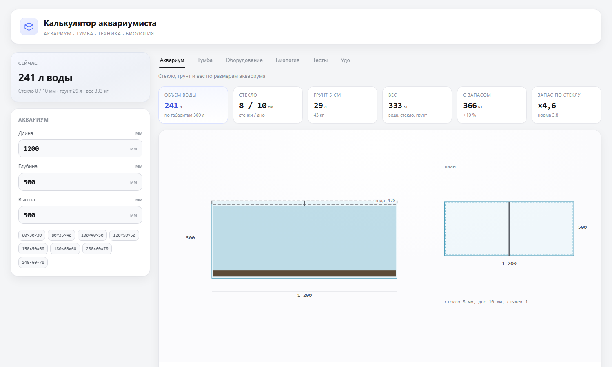

# Aquarium Calculator

[Русская версия](README.ru.md)

[Open the calculator](https://timnurz.github.io/aquarium-stand/)

A single HTML file with no server, build step or dependencies. Enter the tank dimensions and get glass, substrate, weight, a stand cutting plan, equipment sizing, biological load, water tests and a fertilizer recipe. It works offline and saves inputs in the browser.



## Five tabs

- **Aquarium.** Length, depth, height, water level below the rim, substrate and an optional manual water volume. Shows glass thickness, weight and a glass specification.
- **Stand.** Carcass, top panel deflection, cutting plan, drilling schemes, assembly order and dimensions.
- **Equipment.** Filter flow, light, aeration, heater and water changes, all based on water volume.
- **Biology.** Media surface area, TAN capacity, feed load, nitrate and phosphate, and a fish cart.
- **Tests.** Water parameters, targets, CO2, thresholds, water changes and the fertilizer recipe.

The tabs share one model. Tank dimensions set water volume, glass and weight. Weight sets the stand. Water volume sets equipment and biology. Tests and targets set the fertilizer recipe.

## Aquarium

Water level below the rim can be set from 0.5 to 5 cm. It changes the water height, water volume, glass thickness and weight. The water volume can also be entered by hand if the real volume is known; the manual value replaces the calculated volume in volume-based tabs.

Glass thickness uses water height and wall length. The calculation includes a safety factor of 3.8 and rounds to sold sheet thicknesses. Substrate weight depends on layer depth and bulk density. The weight block uses water, glass and substrate, then adds 10 percent for equipment and decor.

## Stand

The top panel is checked as a beam: load, span, plywood stiffness, a 3 mm deflection limit and allowable stress. A double upright or an extra support often helps more than a thicker sheet. The cutting plan is guillotine, with kerf and waste per sheet. Cutting and drilling are separate cards. Drilling schemes show the base point and the face to drill from. Hardware uses confirmats; tools are not listed. Assembly starts with pre-drilling, then the carcass, back panel, tops, shelves and doors.

## Equipment

Filter flow is based on 3 to 5 water volumes per hour. The equipment table has one Filter row with rated flow and the loss allowance. The filter reference is sorted by flow; suitable rows are highlighted in soft green. Lighting is shown as LED watts. Aeration and heating scale with water volume.

## Biology

Biofilter capacity depends on media surface area, not litres of media. Mature biofilm removes about 0.5 g of nitrogen per square metre per day. TAN is the daily ammoniacal nitrogen from fish and waste. Feed protein is about 16 percent nitrogen, and fish retain roughly a quarter of it. The fish table has a name search and a cart; it is a nitrogen limit, not stocking advice.

## Tests

An empty test field means no data, not zero. CO2 is calculated from pH and KH. Thresholds cover ammonia, nitrite, copper and the potassium to calcium ratio. The dose calculation turns the gap between actual values and targets into grams of salts. Fertilizer recipes hold the stock solutions. A separate card lists reference DIY remineralizers for RO water, with GH/KH, hydrate and chloride warnings. Phosphate is kept apart from calcium, magnesium and iron because those phosphates precipitate.

## Language and saved data

English is the default. The RU and EN buttons save the choice in `aqua-lang`. Inputs are saved in `aqua-calc`. `?lang=ru` or `?lang=en` forces a language.

## URL parameters

```
https://timnurz.github.io/aquarium-stand/?l=1500&d=500&h=600&H=900&soil=50#fert
```

- `l`, `d`, `h`: tank length, depth and height in mm
- `H`: stand height in mm
- `soil=50`: substrate layer in mm, one of 0, 30, 50 or 70
- `sheet=2440,1220`: board sheet size
- `color=black`: black finish
- `#tank`, `#stand`, `#gear`, `#bio`, `#fert`: open a tab. `#udo` is an old alias for Tests.
- `#tumba`, `#frame`, `#front`, `#side`, `#detail`: open a stand view
- `lang=ru` or `lang=en`: force a language

## Run locally

Download `index.html` and open it in a browser. No installation is needed.

To publish, run `publish.ps1`. It copies `aquarium-stand.html` to `site/index.html`. Upload the contents of `site/` to the repository root. GitHub Pages updates after the commit.

## Limits

- Glass thickness is an engineering estimate, not a manufacturer datasheet. For tanks longer than 1.5 m, ask a specialist to check it.
- CO2 is calculated without other buffers. Water changes assume the replacement water does not contain the same substance.
- The fish table is an upper nitrogen limit, not compatibility advice.
- Plants and denitrification are not modelled.
- Filter figures are typical datasheet values. Real flow depends on media, hose and lift height.
- TAN and free NH3 from urea are a one-off dose estimate, not hydrolysis kinetics.
- Internal partitions are not modelled.

## Tests

```bash
node --test --test-isolation=none tests/core.test.mjs
```

## License

The project may be used, modified and distributed freely. It is provided as is, without warranty. The author is not liable for calculation results or built structures. Personal and commercial use are allowed. A link to the source is welcome but not required.
