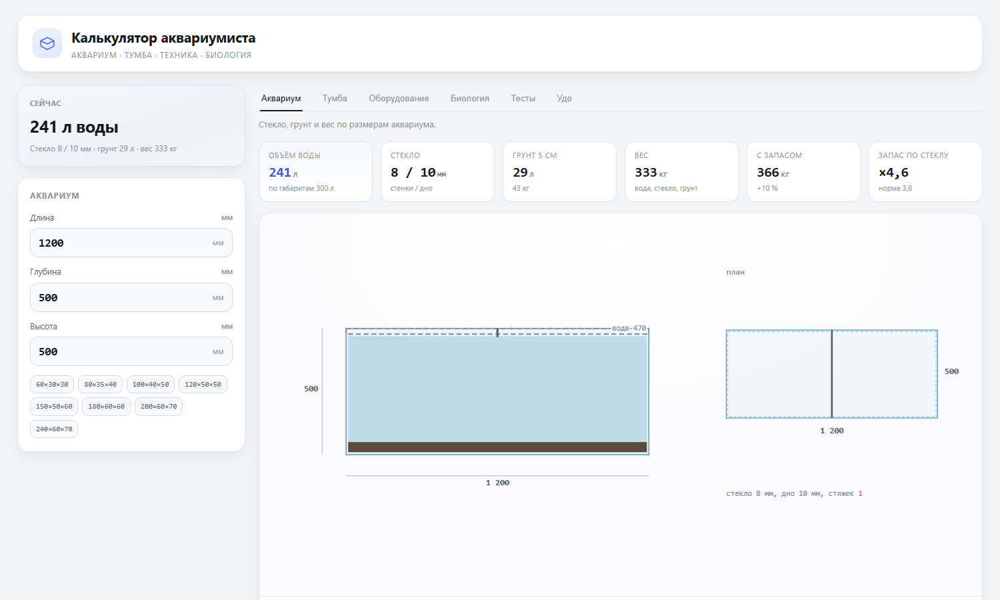

# Калькулятор аквариумиста

🇬🇧 [English version](README.en.md)

**[Открыть калькулятор →](https://timnurz.github.io/aquarium-stand/)**

Одна HTML-страница без сервера и зависимостей: вводите размеры аквариума — получаете расчёт стекла, грунта, веса, тумбы с раскроем фанеры, оборудования, бионагрузки, тестов воды и удобрений.



## Шесть вкладок

| Вкладка | Что показывает |
|---|---|
| **Аквариум** | Толщина стекла с запасом прочности, отбортовка и стяжки, число дверей тумбы, таблица грунтов (объём и вес на 3 / 5 / 7 см), вес всей системы по частям |
| **Тумба** | Изометрия, каркас, вид спереди и сбоку, узел полки, проверка крышки на прогиб, раскрой фанеры по листам, порядок сборки и крепёж |
| **Оборудование** | Фильтр по реальному потоку, свет в люменах, аэрация, обогрев, справочник по 14 моделям фильтров, порядок запуска |
| **Биология** | Мощность биофильтра по площади материала, предел корма и рыбы, накопление нитрата и фосфата, таблица популярных рыб |
| **Тесты** | 15 параметров воды против эталона, CO₂ по pH и KH, рекомендации по порогам, расчёт подмен |
| **Удобрения** | Рецепт солей в граммах: азот делится между калийной, кальциевой селитрой и мочевиной по запасу калия и кальция |

## Как пользоваться

1. Введите длину, глубину и высоту аквариума — или выберите пресет.
2. Если аквариум от 800 мм, выберите число дверей тумбы (по умолчанию подставляется разумное: 3 для 1,2 м).
3. На вкладке «Тумба» задайте высоту и размер листа фанеры.
4. Всё остальное пересчитывается само.

Введённые значения и выбранный язык сохраняются в браузере: при следующем визите всё на месте. Интерфейс переключается между русским и английским кнопкой **RU | EN** в шапке.

## Что считается и по каким формулам

- **Стекло** — пластина, опёртая по трём сторонам. Предел изгиба 40 МПа, запас прочности 3,8. Отбортовка снимает 20 % нагрузки, стяжка — 30 %.
- **Крышка тумбы** — балка на двух опорах. Допустимый прогиб 3 мм, напряжение 8 МПа, фанера с модулем упругости 6 ГПа.
- **Вес** — вода считается как объём минус стекло и грунт, грунт — по насыпной плотности, сверху 10 % запаса.
- **Фильтр** — 3–5 объёмов воды в час по реальному потоку, то есть 55 % от паспортного.
- **Биология** — площадь материала × 0,45 г азота на м² в сутки; 48 мг азота на грамм корма при 40 % белка; температурная поправка Q₁₀ = 2.
- **CO₂** — считается по pH и карбонатной жёсткости.
- **Удобрения** — стехиометрия солей: в нитрате калия 61 % нитрата, в монофосфате калия 70 % фосфата, в сульфате магния 10 % магния.

## Чего калькулятор не делает

- Толщина стекла — инженерная оценка, а не паспорт производителя. Для аквариумов длиннее 1,5 метра её стоит проверить у технолога.
- CO₂ считается в предположении, что в воде нет других буферов.
- Подмены считаются для подменной воды без того же вещества.
- Таблица рыб — только по азотной нагрузке, без стайности, территории и комфорта. Это верхняя граница, а не рекомендация.
- Не учитываются растения и денитрификация, поэтому реальные цифры обычно ниже расчётных.

## Локально

Скачайте `index.html` и откройте двойным кликом — работает без интернета.

Параметры можно передавать ссылкой:

```
https://timnurz.github.io/aquarium-stand/?l=1500&d=500&h=600&H=900#fert
```

- `l`, `d`, `h` — длина, глубина и высота аквариума, мм
- `H` — высота тумбы, мм
- после `#` — вкладка: `tank`, `stand`, `gear`, `bio`, `fert`, `udo`
- `lang=en` — открыть сразу на английском

## Лицензия

Делайте что хотите: используйте, переделывайте, продавайте тумбы.

---

### Для себя: как обновить сайт

1. Правите `aquarium-stand.html` локально.
2. Копируете его в `site/index.html` (или запускаете `publish.ps1`).
3. Загружаете `index.html` на GitHub — Pages пересобирается сам за минуту.
