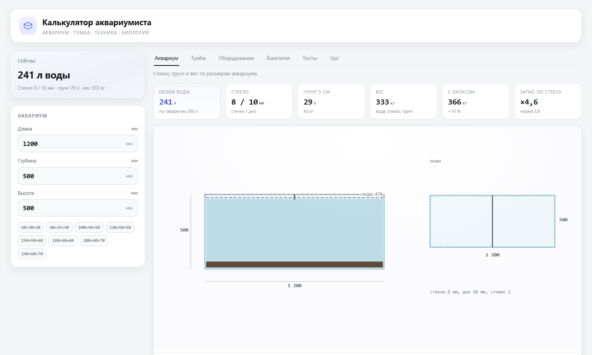

# Калькулятор аквариумиста

🇬🇧 [English version](README.en.md)

**[Открыть калькулятор →](https://timnurz.github.io/aquarium-stand/)**

Одна HTML-страница без сервера, сборки и зависимостей. Вводите размеры аквариума — получаете расчёт стекла, грунта, веса, тумбы с раскроем выбранного материала, оборудования, бионагрузки, тестов воды и удобрений. Работает офлайн, на телефоне, сохраняет введённые значения.




## Для чего

Калькулятор рассчитан на один аквариум и одну тумбу. Подходит для травников от нано до крупных: в пресетах есть 8 размеров — от 600 × 300 × 300 до 2400 × 600 × 700.


Пресет подставляется одной кнопкой; дальше можно менять длину, глубину, высоту и слой грунта, а на вкладке «Тумба» — число дверей.

## Аквариум

**Что вводится.** Длина, глубина и высота аквариума; слой грунта 0 / 3 / 5 / 7 см; готовый пресет.

**Что считается.**

- Толщина стенок и дна с запасом прочности 3,8; отбортовка и стяжки; схема деталей, шов и размеры.
- Габаритный объём по внешним размерам и расчётный объём воды с учётом стекла и выбранного слоя грунта.
- Фактический вес при выбранном слое и максимальный вес для нагрузок: 5 см грунта + 10 %.
- Масса стекла, воды и грунта; таблица грунтов на 3 / 5 / 7 см.
- Внизу — спецификация расчёта стекла: формулы, коэффициенты, пример 1200 × 500 × 500.

**Как читать.** Стекло и тумба всегда считаются по максимальному весу, даже если выбран другой слой. Остальные вкладки используют расчётный объём воды с выбранным слоем. Так тумба получает запас, а оборудование и биология считаются по фактической воде.

## Тумба

**Что вводится.** Высота тумбы; материал корпуса (фанера, ЛДСП, МДФ); толщина 16 или 18 мм; кромка корпуса и кромка двери 0,4 / 1 / 2 мм для ЛДСП; конструкция (цельная или модульная); число дверей в модуле; склеена ли столешница; размер листа; общее число дверей.

**Что показывается.**

- Если дверь одна (например, 60 × 30 × 30), выбор «цельная / модульная» скрыт: разницы нет, остаётся один модуль.
- Неподходящие варианты «дверей в модуле» скрываются: если модуль перегружен, калькулятор сам уменьшает число дверей в модуле, а не показывает предупреждение. Если остаётся только один вариант, сам селектор тоже скрывается.
- В каждом модуле боковины — такие же панели, как наружные; стойки стоят на дне, а вкладная крышка входит между боковинами.
- Изометрия, каркас, вид спереди и сбоку, узел полки.
- Проверка верхней крышки на прогиб: допустимый прогиб 3 мм; напряжение и модуль упругости зависят от материала.
- Раскрой по листам: заготовка считается без кромки, кромка добавляется только на видимые кромки.
- Цельная или модульная конструкция: модули по 1–3 двери, накладная крышка всегда одной деталью. Если крышка не влезает в лист, появляется предупреждение.
- Одинаковые детали из разных модулей сгруппированы в одну строку, без разбивки «модуль 1 / модуль 2».
- Дно в цельной тумбе кромится с трёх сторон; в модульной — у крайних модулей спереди и с наружной стороны, у средних только спереди.
- Вкладная крышка кромится только с лицевой стороны; на трёх остальных сторонах — присадка в торец. В цельной тумбе ещё отверстия в пласти под стойки.
- Боковина снизу присаживается в торец к накладному дну, сверху — в пласть под вкладную крышку.
- Внутренние стойки: оба торца плюс задний торец под вкладную заднюю стенку.
- Задняя стенка: торцы по низу и бокам, верх в пласть, плюс отверстия в пласти по количеству стоек.
- Отдельные селекторы кромки корпуса и кромки двери.
- Внизу раскроя — схемы присадок на каждую деталь: система 32 мм (конфирмат + шкант через 32 мм, пары через 352 мм), чашка Ø35 в дверях и кромка волнистой линией. Отверстие в торце — чёрточка, ответное в пласти — кружок.
- У дна отверстия только в пласти с трёх сторон; в цельной тумбе ещё ряды на местах перегородок. В торце дна отверстий нет.
- Количество деталей, порядок сборки и крепёж.
- Задняя стенка всегда учитывается как связь, снижающая прогиб (коэффициент 0,55). Столешница по умолчанию не считается композитом: между накладной и вкладной крышкой есть теневой зазор.
- Если накладная и вкладная крышки склеены или соединены непрерывно, включите режим «склеена, композит» (коэффициент 0,35).
- Расчёт идёт от максимального веса аквариума, а не от выбранного слоя грунта.

**Фурнитура.** Саморезы 5×70, 4×30 и 3,5×16; полкодержатели Ø5×16; опоры НО-10; накладные петли 110°, по 2 на дверь; проставки под накладную крышку; клей ПВА Д3; межмодульные стяжки для модульной версии.

**Инструменты.** Шуруповерт с битами PH2/PZ2; сверла Ø3, Ø4, Ø5 и сверло Форстнера Ø35; зенкер; шестигранники 3/4/5 мм; киянка, струбцины, угольник, рулетка, карандаш и уровень; утюг/фен, кромкорез и клей для кромки; шлифмашина или шлифовальная губка 120/180; грунт и краска или масло, кисть/валик, лоток и малярный скотч; шпаклевка по дереву, если детали окрашиваются; респиратор и перчатки.

**Порядок сборки.** Раскрой → присадка → кромкование (для ЛДСП) → сборка модулей (для модульной версии) → соединение модулей → корпус → задняя стенка → крышка → полки на полкодержателях → опоры → дверцы → отделка → контроль.

## Оборудование

**Что вводится.** Объём воды берётся с вкладки «Аквариум»; дополнительно выбирается фильтр, а кнопка «Засыпка» подставляет объём материала в биологию.

**Что считается.**

- Фильтр по реальному потоку: 3–5 объёмов воды в час.
- Справочник 40 моделей: канистры, рюкзачки (Hang-on-back) и внутренние. Реальный поток: 55 % от паспорта для канистр, 75 % для рюкзачков, 80 % для внутренних.
- Свет: 20–35 лм/л и 0,3–0,5 Вт/л LED.
- Аэрация: 0,5–1 л/мин на 100 л.
- Обогрев: 0,8–1 Вт/л, кратно 25 Вт.
- Базовая подмена в KPI: 10–20 % в неделю; фактическая — на вкладке «Биология».
- Порядок запуска.

## Биология

**Что вводится.** Материал и объём фильтра, температура, белок корма, процент кормления и вес рыбы.

**Что считается.**

- Площадь материала и мощность биофильтра в г TAN в сутки.
- Предел корма и рыбы по фильтру; фактическая загрузка.
- Накопление NO₃ и PO₄ без растений, соотношение NO₃ : PO₄ и подмена до 20 мг/л.
- Таблица топ-50 популярных рыб: вес взрослой особи, процент кормления, лимит по фильтру и объёму.
- Корзина: количество → общий вес → корм в граммах; итоговая строка. Корзина обновляет поля «Рыба» и «Кормление» в блоке «Фильтр», но их можно править вручную.

**Важно.** Это расчёт только по азотной нагрузке, без стайности, территории и комфорта. Растения и денитрификация не учитываются.

## Тесты

Одна вкладка: показатели, цели, рекомендации и рецепт. Ввод — карточка «Показатели и цели» в две колонки, «Факт» и «Цель»: pH, KH, GH, TDS, EC, аммоний TAN, NO₂, NO₃, PO₄, K, Ca, Mg, Fe, Cu и температура слева; pH, KH, GH, NO₃, PO₄, K, Ca, Mg, Fe справа. Пустое поле означает «нет теста».

**Индикаторы.** Рядом с каждым параметром — точка: зелёная (в норме или в пределах допуска цели), жёлтая (отклонение), красная (критическое). Норма и цель видны в подсказке при наведении; норма крупно написана рядом с названием.

**Допуск.** Тесты редко бывают точными, поэтому цель считается достигнутой в пределах допуска: pH ±0,2; KH ±0,5; GH ±1; NO₃ ±2; PO₄ ±0,2; K ±2; Ca ±5; Mg ±2; Fe ±0,02. В этих же пределах рецепт не назначает дозу.

**Профиль.** Три набора норм: «Травник с CO₂», «Травник без CO₂», «Общий аквариум». Переключатель стоит над карточкой, выбор сохраняется.

**Что делать и подмены.** По одному действию на каждое отклонение от цели (или от нормы, если цели нет), плюс соотношения Ca : Mg, K : Ca и N : P. «Подмены» — доля объёма до нормы или цели; считаются только растворённые вещества, pH и KH подменой не правят.

**Рецепт.** Ниже, на этой же вкладке:

- соли в граммах: KNO₃, Ca(NO₃)₂, мочевина, KH₂PO₄, K₂SO₄, MgSO₄·7H₂O, CaCl₂·2H₂O, NaHCO₃, CSM+B;
- KH добирается пищевой содой: ≈3,0 г NaHCO₃ на 100 л на 1 °dKH; понижение — только подмена или осмос;
- GH добирается GH-бустером (CaCl₂ + MgSO₄, 2 : 1), если цели по Ca и Mg не заданы; если заданы — они и определяют GH, расхождение показывается предупреждением;
- pH солями не меняется: для цели по pH считается нужный CO₂ при текущем KH и выводится карточка «pH и CO₂»;
- дозы концентратов (0,5 л) в мл и число флаконов; «После дозы»: сейчас → станет → цель;
- предупреждения: нет теста, цель вне нормы, K/Ca/GH выше цели, навеска больше флакона, NH₃ от мочевины, конфликт GH с Ca/Mg.

**Логика.** Азот: KNO₃ до цели по калию → Ca(NO₃)₂ до цели по кальцию → остаток мочевиной. Если K или Ca уже выше цели, селитра не используется. Кальций при достаточном азоте добирается CaCl₂. Без теста элемента доза не рассчитывается.

## Общие принципы

- **Одна страница.** Нет сервера и зависимостей; можно скачать `index.html` и открыть офлайн.
- **Язык.** При первом открытии RU или EN по языку браузера/устройства; ручной выбор кнопкой **RU | EN** запоминается. `?lang=ru` или `?lang=en` — принудительно.
- **Сохранение.** Введённые значения хранятся в `localStorage` браузера.
- **Мобильная вёрстка.** Компактные отступы, прокручиваемые вкладки, одна колонка таблиц и раскроя, безопасные зоны iPhone.
- **Связи.** Размеры и слой грунта обновляют все вкладки; корзина рыб — поля фильтра; тесты и цели — рецепт удобрений.
- **Ядро.** Чистые функции в блоке `<script id="aqua-core">`: нормы, оценка, рецепт, подмены. Не обращаются к DOM и покрыты тестами.

## Ядро и тесты

Приложение остаётся одним файлом `index.html`: стили, разметка, ядро и UI внутри. Ядро вынесено в блок `<script id="aqua-core">`, не обращается к DOM и не зависит от языка.

Тесты ядра:

```bash
node --test --test-isolation=none tests/core.test.mjs
```

`--test-isolation=none` нужен, чтобы тесты шли в одном процессе: в некоторых средах дочерние процессы запрещены.

## Ограничения

- Толщина стекла — инженерная оценка, а не паспорт производителя; для длины больше 1,5 м её стоит проверить у технолога.
- CO₂ считается без других буферов; подмены — для воды без того же вещества.
- Таблица рыб — верхняя граница по азоту, а не рекомендация по совместимости.
- Вес и процент кормления в топ-50 — ориентиры; рыба-клоун морская и оставлена справочно.
- Характеристики фильтров — типовые паспортные данные; реальный поток зависит от наполнителя, шланга и высоты подъёма.
- Срок хранения концентратов зависит от воды и условий.
- Нормы заданы для трёх пресноводных профилей; морской аквариум не поддерживается.
- TAN и свободный NH₃ от мочевины — оценка разовой дозы, а не динамика гидролиза.
- Коэффициенты 0,55 для задней стенки и 0,35 для композитной столешницы — инженерные оценки совместной работы, а не точный расчёт клеевого соединения.
- Внутренние перегородки не рассчитываются; растения и денитрификация не учитываются.

## Локально

Скачайте `index.html` и откройте двойным кликом — работает без интернета.

Параметры можно передавать ссылкой:

```
https://timnurz.github.io/aquarium-stand/?l=1500&d=500&h=600&H=900&soil=50#fert
```

- `l`, `d`, `h` — длина, глубина и высота аквариума, мм
- `H` — высота тумбы, мм
- `soil=50` — слой грунта, мм: 0 / 30 / 50 / 70
- `sheet=2440,1220` — размер листа материала
- `color=black` — чёрный цвет
- после `#` — вкладка: `tank`, `stand`, `gear`, `bio`, `fert` (`#udo` ведёт на «Тесты»)
- для «Тумбы» можно открыть подвкладку: `#tumba`, `#frame`, `#front`, `#side`, `#detail`
- `lang=ru` или `lang=en` — принудительный язык

## Лицензия

Проект можно свободно использовать, изменять и распространять. Он предоставляется «как есть», без гарантий: автор не несёт ответственности за последствия расчётов и собранных конструкций.

Использование в личных и коммерческих проектах разрешено. Ссылка на исходник приветствуется, но не обязательна.

## Разработка

Исходник — `aquarium-stand.html`. Публикация: `publish.ps1` копирует его в `site/index.html`; в корень репозитория GitHub Pages загружается содержимое `site/` — `index.html`, `README.md`, `README.en.md`, `screenshot.png` и изображение с травниками. После коммита Pages обновляется автоматически.

Для локальной проверки достаточно открыть `index.html` в браузере.

Актуальная версия лежит в `site/index.html`. Если публикуете через `publish.ps1`, сначала синхронизируйте с ней `aquarium-stand.html`, иначе скрипт перезапишет сайт старой версией.
