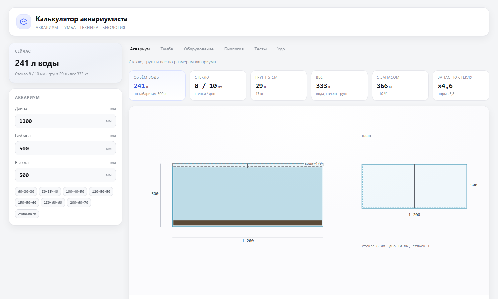

# Калькулятор аквариумиста

[English version](README.md)

[Открыть калькулятор](https://timnurz.github.io/aquarium-stand/)

Одна HTML-страница без сервера, сборки и зависимостей. Введите размеры аквариума и получите расчёт стекла, грунта, веса, раскроя тумбы, оборудования, бионагрузки, тестов воды и рецепта удобрений. Страница работает офлайн и сохраняет введённые значения в браузере.



## Пять вкладок

- **Аквариум.** Длина, глубина, высота, уровень воды ниже кромки, грунт и необязательный ручной объём воды. Показывает толщину стекла, вес и спецификацию.
- **Тумба.** Корпус, прогиб крышки, раскрой, схемы присадок, порядок сборки и размеры.
- **Оборудование.** Поток фильтра, свет, аэрация, обогрев и подмены по объёму воды.
- **Биология.** Площадь засыпки, мощность по TAN, нагрузка от корма, нитрат и фосфат, корзина рыб.
- **Тесты.** Показатели воды, цели, CO2, пороги, подмены и рецепт удобрений.

Вкладки используют одну модель. Размеры аквариума задают объём воды, стекло и вес. Вес задаёт нагрузку на тумбу. Объём воды задаёт оборудование и биологию. Тесты и цели задают рецепт удобрений.

## Аквариум

Уровень воды ниже кромки можно выбрать от 0,5 до 5 см. Он меняет высоту воды, объём, толщину стекла и вес. Если известен фактический объём воды, его можно ввести вручную; это значение заменит расчётный объём в объёмных вкладках.

Толщина стекла зависит от высоты воды и длины стенки. В расчёте есть запас 3,8, результат округляется до продаваемых толщин. Вес грунта зависит от слоя и насыпной плотности. Вес аквариума складывается из воды, стекла и грунта, затем добавляется 10 процентов на оборудование и декор.

## Тумба

Крышка проверяется как балка: нагрузка, пролёт, жёсткость фанеры, предел прогиба 3 мм и допустимое напряжение. Дополнительная стойка часто помогает сильнее, чем более толстый лист. Раскрой гильотинный, с пропилом и отходом по каждому листу. Раскрой и присадка разделены на две карточки. На схемах присадок указаны база и сторона сверления. В фурнитуре используются конфирматы, инструменты не перечисляются. Сборка начинается с присадки, затем корпус, задняя стенка, крышки, полки и дверцы.

В видах тумбы есть вкладка «Нагрузка»: вес аквариума с запасом, вес тумбы и процент на оборудование в тумбе, площадь опоры, нагрузка на перекрытие в кг/м² и psf и запас относительно выбранной конструкции. Ниже таблица типовых несущих конструкций России (СП 20.13330, плиты ПК/ПБ, монолит, пол по грунту) и США (IRC R301.5). Оценка статическая и консервативная: нормативная полезная нагрузка сравнивается с постоянным весом банки; для деревянных перекрытий важны сечение и шаг балок.

## Оборудование

Поток фильтра — 3–5 объёмов воды в час; это уже с учётом падения производительности, поэтому в таблице оборудования поток остаётся справочным. Сам фильтр подбирается по паспортному объёму аквариума: модель должна быть рассчитана на объём от текущего до 2,5× больше. В справочнике есть колонка «Аквариум, л» и паспортный с реальным потоком; мягким зелёным подсвечены подходящие по объёму модели. Для банок больше 600 л добавляются комплекты из двух фильтров — одного не хватает. Освещение показано в ваттах LED. Аэрация и обогрев зависят от объёма воды.

## Биология

Мощность биофильтра зависит от площади засыпки, а не от литров. Зрелая плёнка снимает около 0,5 г азота с квадратного метра в сутки. TAN: суточное количество аммонийного азота от рыб и отходов. В белке около 16 процентов азота, рыба удерживает примерно четверть. В таблице рыб есть поиск по названию и корзина; она показывает предел по азоту, а не рекомендацию по совместимости.

## Тесты

Пустое поле теста означает отсутствие данных, а не ноль. CO2 считается по pH и KH. Пороги проверяют аммиак, нитрит, медь и отношение калия к кальцию. Расчёт дозы переводит разницу между фактом и целью в граммы солей. В «Рецептах удо» лежат концентраты. Отдельная карточка показывает ориентировочные самодельные реминерализаторы для осмоса, с предупреждениями по GH/KH, гидратам и хлоридам. Фосфат хранится отдельно от кальция, магния и железа, потому что их фосфаты выпадают в осадок.

## Язык и сохранение

По умолчанию английский. Кнопки RU и EN сохраняют выбор в `aqua-lang`. Введённые значения сохраняются в `aqua-calc`. `?lang=ru` или `?lang=en` принудительно задаёт язык.

Кнопки «мм» и «in» рядом с языком переключают единицы (выбор хранится в `aqua-units`): аквариум, оборудование и расчёт нагрузки переводятся в дюймы, галлоны, фунты, gph и psf. Чертежи, раскрой и присадка тумбы остаются в миллиметрах как рабочая документация; размеры листов и кромки тоже в мм.

## Параметры ссылки

```
https://timnurz.github.io/aquarium-stand/?l=1500&d=500&h=600&H=900&soil=50#fert
```

- `l`, `d`, `h`: длина, глубина и высота аквариума в мм
- `H`: высота тумбы в мм
- `soil=50`: слой грунта в мм, одно из значений 0, 30, 50 или 70
- `sheet=2440,1220`: размер листа материала
- `color=black`: чёрная отделка
- `#tank`, `#stand`, `#gear`, `#bio`, `#fert`: открыть вкладку. `#udo`: старый псевдоним для «Тестов».
- `#tumba`, `#frame`, `#front`, `#side`, `#detail`: открыть вид тумбы
- `lang=ru` или `lang=en`: принудительный язык

## Локально

Скачайте `index.html` и откройте в браузере. Установка не нужна.

Публикация: `publish.ps1` копирует `aquarium-stand.html` в `site/index.html`. Загрузите содержимое `site/` в корень репозитория. GitHub Pages обновится после коммита.

## Ограничения

- Толщина стекла: инженерная оценка, а не паспорт производителя. Для банок длиннее 1,5 м покажите расчёт технологу.
- CO2 считается без других буферов. Подмены рассчитаны для воды без того же вещества.
- Таблица рыб показывает верхний предел по азоту, а не совместимость.
- Растения и денитрификация не моделируются.
- Данные фильтров: типовые паспортные значения. Объём засыпки — по размерам сменной губки (для внутренних) или корзины/камеры (для канистр и рюкзачков); где размеров найти не удалось, стоит ≈ (оценка по габаритам корпуса). Реальный поток зависит от наполнителя, шланга и высоты подъёма.
- TAN и свободный NH3 от мочевины: оценка разовой дозы, а не динамика гидролиза.
- Внутренние перегородки не рассчитываются.

## Тесты

```bash
node --test --test-isolation=none tests/core.test.mjs
```

## Лицензия

Проект можно свободно использовать, изменять и распространять. Он предоставляется как есть, без гарантий. Автор не отвечает за результаты расчётов и собранные конструкции. Личное и коммерческое использование разрешено. Ссылка на исходник приветствуется, но не обязательна.
